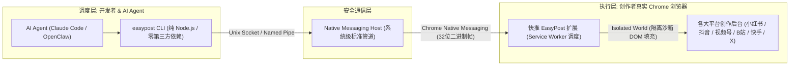

# ⚡ 快推 EasyPost · 极速多平台内容分发与 AI Agent 自动化

<div align="center">

[](https://nodejs.org/)
[](https://opensource.org/licenses/MIT)
[](./skills/)
[](https://skills.sh)
[](https://chromewebstore.google.com/detail/ajdpfajmgibbniipjfgjiappllekpiak)

**面向现代自媒体创作者与 AI Agent 的轻量级多平台一键分发工具**  
*零风控、免配置 Cookie、复用日常真实 Chrome 浏览器，一键并发同步全网短视频与图文笔记*

[💡 核心亮点](#-核心亮点与架构对比) • [📊 平台支持](#-平台支持矩阵) • [🤖 AI Agent 技能](#-ai-agent-技能与-skillssh) • [🏁 快速开始](#-快速开始) • [📚 深度技术评测与教程](#-深度技术评测与-seo-教程库)

</div>

---

## 💡 核心亮点与架构对比

与基于 Playwright、Puppeteer、Selenium 等无头浏览器的传统自动化脚本不同，**EasyPost 采用 Chrome 原生 Native Messaging IPC 桥接架构**，彻底杜绝了被平台识别为“机器人营销号”的风险。



### 为什么选择 EasyPost？

1. **🛡️ 零风控暴露，杜绝封号**：
   - 寄生在创作者日常上网的真实 Chrome 浏览器中，拥有 100% 真实的 Canvas/WebGL 硬件指纹；
   - 脚本运行在 Chrome 强制隔离的 `Isolated World` 沙箱中，页面前端反爬 SDK 无法探测自动化痕迹；
   - 独创 **`fill` 模式**：自动完成繁琐的文件上传、文案与标签排版，最终点击由创作者真鼠标物理触发（`event.isTrusted = true`），从原理上彻底消除自动化风控。
2. **🔑 零 Cookie 维护与泄露风险**：
   - 无需手动导出 Cookie，无需向工具提供账号密码，100% 直接复用浏览器当前已登录状态。
3. **⚡ 原生多平台并发分发（Combos）**：
   - 告别单平台线性串行等待，一个请求即可在 Chrome 后台静默并发拉起 5~10 个平台 Tab 同步分发。
4. **📐 智能多规格适配引擎**：
   - 同一组素材自动按 16:9 / 9:16 宽高比**自适应分流横竖版封面**；
   - 毫秒级规则字典：小红书标题 20 字、抖音 30 字、视频号 16 字且禁标点，违规即时拦截。
5. **🤖 专为 AI Agent（Claude Code / OpenClaw）原生优化**：
   - CLI 纯 JSON 输入输出，无进度条噪声；内置全套标准化 `SKILL.md`，已被 `skills.sh` 等平台自动索引。

---

## 📊 平台支持矩阵

| 平台 | 内容形态 | 专用 Agent Skill | 支持模式 | 平台核心规则说明 |
| :--- | :--- | :--- | :--- | :--- |
| **小红书** | 图文笔记 (imageText) / 短视频 (shortVideo) | [`xiaohongshu-upload`](./skills/xiaohongshu-upload/SKILL.md) | `fill` / `publish` | 标题 ≤ 20 字，文案 ≤ 1000 字 |
| **抖音** | 短视频 (shortVideo) / 图文笔记 (imageText) | [`douyin-upload`](./skills/douyin-upload/SKILL.md) | `fill` / `publish` | 标题 ≤ 30 字，支持下载权限设置与自主声明 |
| **微信视频号** | 短视频 (shortVideo) | [`shipinhao-upload`](./skills/shipinhao-upload/SKILL.md) | `fill` / `publish` | **短标题 ≤ 16 字且严禁包含任何标点符号** |
| **哔哩哔哩** | 视频投稿 (shortVideo) / 动态 (dynamic) | [`bilibili-upload`](./skills/bilibili-upload/SKILL.md) | `fill` / `publish` | 标题 ≤ 80 字，推荐 16:9 横版封面 (`horizontalCover`) |
| **快手** | 短视频 (shortVideo) / 图文 (imageText) | [`kuaishou-upload`](./skills/kuaishou-upload/SKILL.md) | `fill` / `publish` | 描述 ≤ 300 字，支持话题标签与下载权限 |
| **微博** | 动态图文 (dynamic) / 视频 (shortVideo) | [`weibo-upload`](./skills/weibo-upload/SKILL.md) | `fill` / `publish` | 支持 1~9 图与 `#话题#` |
| **X (Twitter)**| 动态推文 (dynamic) / 视频 (shortVideo) | [`x-upload`](./skills/x-upload/SKILL.md) | `fill` / `publish` | 单条推文 ≤ 280 字符 |
| **Instagram** | 帖子轮播 (imageText) / Reels 视频 (shortVideo)| [`instagram-upload`](./skills/instagram-upload/SKILL.md) | `fill` / `publish` | 推荐 1:1 或 9:16 高清素材 |

---

## 🤖 AI Agent 技能与 skills.sh

本仓库包含符合 `skills.sh` 与 OpenClaw 官方规范的 Agent 技能集合。你可以直接在终端将技能挂载到你的 AI 助手（如 Claude Code、OpenClaw）：

### 安装总入口技能：
```bash
npx skills add gybin02/easypost --skill easypost
```

### 或安装指定平台技能：
```bash
npx skills add gybin02/easypost --skill xiaohongshu-upload
npx skills add gybin02/easypost --skill douyin-upload
npx skills add gybin02/easypost --skill shipinhao-upload
```

> 💡 **快速引导 Prompt**：如果你希望让 AI 助手直接接管配置并自动分发，请查阅 [Agent 引导提示词（Bootstrap Prompt）](./docs/agent-bootstrap.md)。

---

## 🏁 快速开始

### 1. 安装 Chrome 扩展
在 Chrome 中安装【快推 EasyPost】扩展，并保持 Chrome 处于打开状态：
* [Chrome 应用商店安装地址（4.4★ 好评）](https://chromewebstore.google.com/detail/ajdpfajmgibbniipjfgjiappllekpiak)（或在 GitHub Releases 下载离线 `.crx`）

### 2. 全局安装 CLI
```bash
npm install -g easypost-cli
# 或者从本仓库本地安装：npm install -g ./cli
```

### 3. 系统级配对与健康检查
```bash
easypost install-host
easypost doctor --wait 30
```
返回 `ok: true` 且 `bridge.state: "connected"` 时，即表示配对成功！

### 4. 执行一次多平台自动填充
创建任务描述文件 `task.json`：
```json
{
  "type": "imageText",
  "platforms": ["xiaohongshu", "douyin"],
  "data": {
    "title": "极简日常生产力工具推荐",
    "content": "分享一套能够大幅提升创作效率的多平台分发工作流... #生产力工具 #自媒体矩阵",
    "tags": ["生产力工具", "自媒体矩阵"]
  },
  "assets": [
    {
      "path": "/Users/me/Pictures/cover.png",
      "role": "media"
    }
  ]
}
```

运行填充命令：
```bash
easypost fill --input task.json
```
扩展将瞬间在 Chrome 中自动打开对应平台标签页，自动拖拽上传图片、填写标题与正文。你只需在浏览器核对无误后，轻点发布即可！

---

## 📚 深度技术评测与 SEO 教程库

为了帮助开发者和自媒体团队深入理解自动化底层原理与风控对抗机制，我们在 `docs/` 目录准备了一系列深度技术横评：

1. 📖 [《多平台社交媒体分发方案横评：Chrome 扩展 Native Messaging vs Playwright / Puppeteer 自动化》](./docs/rpa-vs-extension.md)  
   *从 CDP 运行时反爬探针、V8 调试堆栈泄露、物理事件触发机制等底层深度横评两套自动化流派。*
2. 🛡️ [《为什么基于真实 Chrome 扩展的分发方案能避免 90% 的封号与验证码拦截？》](./docs/anti-risk-principles.md)  
   *拆解各大平台前端风控模型、Isolated World 沙箱隔离机制与 `event.isTrusted` 物理点击防封原理解析。*
3. ⚖️ [《主流自媒体矩阵自动化工具架构对比：EasyPost vs social-auto-upload vs 传统 RPA》](./docs/tools-comparison.md)  
   *对比影刀/八爪鱼等屏幕点击 RPA、Python 脚本工具与 Chrome 扩展混合架构在并发、维护性与体验上的差异。*
4. 🚀 [《使用 AI Agent（Claude Code / OpenClaw）搭建端到端多平台自动分发工作流实战》](./docs/ai-agent-workflow.md)  
   *手把手教你如何用大语言模型全自动生产图文视频，并通过 EasyPost Skill 一句话全网分发的实战指南。*
5. 🛠️ [《EasyPost CLI 详细命令与 JSON Schema 使用手册》](./docs/CLI.md)

---

## 🤝 贡献与社区

欢迎提交 Issue 和 Pull Request！
* 提交新平台适配前，请确保在 `skills/<platform>-upload/` 补充对应的 `SKILL.md`；
* 规范遵循 MIT 许可证。

## 📜 许可证

本项目开源部分（CLI 工具、Agent Skills 及文档）基于 [MIT License](./LICENSE) 开源发布。
