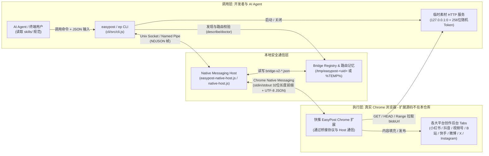

# EasyPost 技术架构文档

> 本文档基于 `gybin02/easypost` 仓库现有源码与文档编写，用于说明系统的整体架构、CLI 模块划分、Native Messaging 桥接机制、发布任务数据流、Agent Skills 组织方式及关键设计约束。
>
> **边界说明**：本仓库仅包含本地 CLI / Native Messaging Host（`cli/`）、Agent Skills（`skills/`）与技术文档（`docs/`），**不包含 Chrome 浏览器扩展本体源码**。文中涉及扩展侧行为时，仅依据本仓库代码中可观测的桥接协议接口与现有文档描述。

---

## 1. 项目定位与整体架构

**EasyPost（快推）** 是一套面向自媒体创作者与 AI Agent（如 Claude Code、OpenClaw 等）的轻量级本地多平台内容分发工具。它不依赖 Playwright、Puppeteer 等受控无头浏览器，也不保存任何平台账号密码或 Cookie，而是通过 **Chrome Native Messaging 本地 IPC 管道** 连接到用户日常使用的真实 Chrome 浏览器中的【快推 EasyPost】扩展，直接复用浏览器当前已登录会话完成多平台内容的自动填充（`fill`）或自动发布（`publish`）。

### 核心技术特征

- **零第三方依赖**：`cli/` 采用纯 Node.js（`>= 20`）ES Module 实现，`cli/package.json` 不包含任何外部运行时依赖。
- **面向 Agent 的纯 JSON 契约**：所有 CLI 命令仅向 `stdout` 输出单行结构化 JSON（失败时向 `stderr` 输出错误 JSON），无进度条或 ANSI 噪声，配合确定性退出码供程序与 AI Agent 解析。
- **安全双轨制**：默认推荐 `fill` 模式（自动完成文件上传与排版填充，由用户在浏览器中物理点击发布）；仅在显式传入 `--yes` 时执行 `publish`。

### 整体架构图



---

## 2. 目录结构说明

仓库中各目录与核心文件组织如下（不含未在本仓库开源的 Chrome 扩展源码）：

```text
easypost/
├── README.md                        # 项目总览、架构简介、快速开始与平台矩阵
├── LICENSE                          # MIT 开源许可证
├── assets/
│   └── feishu-group.png             # 官方交流群二维码图片
├── cli/                             # 本地 CLI 与 Native Messaging Host 实现（easypost-cli）
│   ├── package.json                 # 包配置（Node >= 20, ESM, 无第三方依赖, bin 与 exports）
│   ├── README.md                    # CLI 使用说明与协议补充说明
│   ├── bin/
│   │   ├── easypost.js              # CLI 主入口（调用 runCli）
│   │   ├── ep.js                    # CLI 短别名入口（同 easypost.js）
│   │   └── easypost-native-host.js  # Chrome 启动 Native Host 的入口脚本
│   ├── src/                         # 核心源码（18 个模块，职责见第 3 节）
│   └── test/
│       └── cli.test.js              # 基于 node --test 的 CLI 与桥接单元测试
├── docs/                            # 技术文档与评测文章
│   ├── ARCHITECTURE.md              # 本文档：技术架构说明
│   ├── CLI.md                       # CLI 命令、JSON Schema 与退出码手册
│   ├── agent-bootstrap.md           # AI Agent 自主探索与接管引导 Prompt
│   ├── ai-agent-workflow.md         # 端到端 AI Agent 多平台分发工作流实战
│   ├── anti-risk-principles.md      # 真实 Chrome 扩展防封号与风控对抗原理解析
│   ├── rpa-vs-extension.md          # Native Messaging 扩展 vs Playwright/CDP 深度横评
│   └── tools-comparison.md          # EasyPost vs social-auto-upload vs 传统 RPA 对比
└── skills/                          # 适配 skills.sh / OpenClaw 的 Agent 技能集合
    ├── easypost/SKILL.md            # 多平台分发总入口 Skill
    ├── bilibili-upload/SKILL.md     # 哔哩哔哩（视频投稿 / 动态）
    ├── douyin-upload/SKILL.md       # 抖音（短视频 / 图文）
    ├── instagram-upload/SKILL.md    # Instagram（帖子轮播 / Reels）
    ├── kuaishou-upload/SKILL.md     # 快手（短视频 / 图集）
    ├── shipinhao-upload/SKILL.md    # 微信视频号（短视频 16 字纯文本校验）
    ├── weibo-upload/SKILL.md        # 微博（动态图文 / 视频）
    ├── x-upload/SKILL.md            # X / Twitter（推文动态 / 视频）
    └── xiaohongshu-upload/SKILL.md  # 小红书（图文笔记 / 短视频）
```

---

## 3. CLI 的模块划分与各自职责

`cli/package.json` 对外暴露了 `easypost`、`ep`（均指向 `bin/easypost.js`）和 `easypost-native-host` 三个可执行入口，并通过 `exports` 导出了 `.`、`./asset-server`、`./bridge`、`./framing`、`./host-install`、`./schema` 六个子路径。`cli/src/` 下 18 个模块按职责可分为六层：

| 层次 | 模块文件 | 核心职责与导出 |
| :--- | :--- | :--- |
| **命令编排与入口** | `cli/src/cli.js` | 参数解析（`parseArgv`）、命令分发（`runParsedCommand`）、输入加载、执行前准备（`prepareInput`）、任务执行生命周期控制（`executePrepared`）、终态校验（`throwForExecuteStatus`）以及统一的 `stdout`/`stderr` JSON 包装（`runCli`）。 |
| | `cli/src/index.js` | 包主入口，统一汇总导出 `cli/src/` 下各核心模块 API。 |
| **基础契约与错误** | `cli/src/constants.js` | 定义全局常量：包版本、`PROTOCOL_VERSION = 1`、Schema 标识、`NATIVE_HOST_NAME = "com.easypost.cli"`、官方与历史扩展 ID（`OFFICIAL_EXTENSION_ID` / `LEGACY_EXTENSION_ID`）、`MAX_NATIVE_MESSAGE_BYTES`（`1024 * 1024 - 1`）、默认超时、退出码表 `EXIT_CODES`（`0, 2, 10, 20, 21, 22, 30, 40`）、内容形态 `CONTENT_TYPES` 与素材角色 `ASSET_ROLES`。 |
| | `cli/src/errors.js` | 定义 `CliError` 类及错误码映射：`exitCodeForRemoteCode`、`remoteErrorToCliError`、`asCliError`，将远端扩展/宿主错误码归类为本地退出码。 |
| **输入校验与摘要** | `cli/src/schema.js` | 严格解析与规范化任务 JSON（`parseInputJson`、`normalizeInput`、`validateRequestId`），校验字段白名单、`browserContext`、`comboName`、`publishGuard`（含即刻圈子必填校验）以及平台硬性规则（如 `shipinhao` 短视频标题 `<= 16` 字且仅限文字/数字/空格）。 |
| | `cli/src/x-article-images.js` | 针对单平台 `x` 的 `article` 任务，通过 `prepareXArticleImages` 与 `limitXArticleImages` 将正文内超过 `X_ARTICLE_IMAGE_LIMIT`（25 张）的图片替换为人工补图占位文本并保留原地址记录（`data.xArticleImageOverflow`）。 |
| | `cli/src/canonical-json.js` | 提供键顺序无关的规范化 JSON 序列化（`canonicalStringify`）与 `createPayloadDigest`，对任务核心参数与素材元数据计算 SHA-256 摘要（排除本地 `path` 与临时 `blobUrl`）。 |
| **素材检查与传输** | `cli/src/mime.js` | 基于文件头魔数嗅探（`sniffMime`，支持 PNG/JPEG/GIF/WEBP/WAV/AVI/HEIC/HEIF/AVIF/MP4/MOV/PDF/ZIP/OGG/MP3/WEBM 等）与扩展名映射（`mimeFromPath`）推断 MIME 类型（`resolveMime`）。 |
| | `cli/src/assets.js` | `inspectAsset` / `inspectAssets`：串行流式读取本地素材文件（避免大文件全量载入内存），计算字节大小与 SHA-256，校验文件名长度与普通文件属性，并附加不可枚举的 `_fileIdentity`（`dev`/`ino`/`mtimeMs`/`ctimeMs`）用于防篡改检测。 |
| | `cli/src/asset-server.js` | `startAssetServer`：在 `127.0.0.1:0` 启动仅限本机回环的临时 HTTP 服务，使用 256 位随机 hex token 隔离路由 `/v1/assets/<token>/<index>/<name>`；支持 `OPTIONS`/`HEAD`/`GET` 与单段 `Range`（`parseByteRange`），响应头强制包含 CORS、Private Network Access（`Access-Control-Allow-Private-Network: true`）、`Cache-Control: no-store` 与 `ETag`，并在传输前核对 `_fileIdentity`（若文件被修改则返回 `409`）。 |
| **桥接与 IPC 通信** | `cli/src/ndjson.js` | `NdjsonParser` 与 `encodeNdjson`，实现 CLI 与 Native Host 之间的换行分隔 JSON（NDJSON）编解码，限制单条消息不超过 `MAX_NATIVE_MESSAGE_BYTES`。 |
| | `cli/src/native-framing.js` | `NativeMessageParser`、`encodeNativeMessage`、`writeNativeMessage`，实现 Chrome Native Messaging 标准的 4 字节本机字节序长度前缀 + UTF-8 JSON 帧编解码，严格限制单帧小于 1 MiB。 |
| | `cli/src/socket-path.js` | 计算跨平台运行目录（`defaultRuntimeDirectory`）、v1 兼容 Socket/Named Pipe 路径（`getSocketPath`、`getSocketCandidates`），并在 Unix 下通过 `ensureSecureSocketDirectory` 强制目录 `0700` 权限与当前用户属主校验。 |
| | `cli/src/browser-owner.js` | macOS 下通过 `ps` 查询父进程可执行路径（`nativeHostBrowserNamespace`、`browserSocketNamespace`），对非标准 Google Chrome 宿主生成 `browser-<sha256前12位>` 命名空间，防止与其他 Chromium 内核浏览器加载相同扩展 ID 时端口冲突。 |
| | `cli/src/bridge-registry.js` | 实现 v2 桥接身份生成（`createBridgeIdentity`）、实例专属 Socket 路径（`instanceSocketPath`）、注册表原子写入与安全读取（`registerBridge`、`readBridgeRegistry`），以及 `requestId -> bridgeId` 本地路由记忆（`rememberRequestRoute`、`readRequestRoute`）。 |
| | `cli/src/native-host.js` | `startNativeHost`：Native Messaging Host 核心实现，负责接收扩展启动握手、创建本地 IPC Socket 服务、校验请求上下文与 `bridgeTarget`、通过 `pending` 表并发复用连接并向扩展串行写入 Native 帧。 |
| | `cli/src/bridge-client.js` | CLI 侧桥接客户端：`requestBridge`、`waitForBridge`、`discoverBridges`、`resolveBridgeSelection`、`waitForBridgeSelection`，完成活体握手、多实例发现与单次请求生命周期管理。 |
| **Host 安装与诊断** | `cli/src/host-install.js` | 扫描 Chrome Profile 的 `Preferences` / `Secure Preferences` 自动发现扩展 ID（`discoverExtensionIds`），生成 `.sh`/`.cmd` 启动包装器与系统级 NativeMessagingHosts 清单（macOS/Linux 写入 JSON，Windows 额外写入 `HKCU` 注册表），提供 `installNativeHost`、`uninstallNativeHost`、`inspectNativeHostInstallation` 与 `diagnoseNativeHost`。 |

---

## 4. Native Messaging Host 与桥接（Bridge）的通信机制

EasyPost 在本地采用 **两段式 IPC 桥接**，将短暂运行的 CLI 进程与由 Chrome 生命周期托管的 Native Messaging Host 解耦：

1. **CLI ↔ Native Host**：基于本机 Unix Domain Socket（macOS/Linux）或 Named Pipe（Windows），使用 **NDJSON**（`\n` 分隔的 UTF-8 JSON，兼容 `\r\n`）传输请求与响应。
2. **Native Host ↔ Chrome 扩展**：基于标准输入输出（`stdin`/`stdout`），严格遵循 Chrome Native Messaging 协议的 **32 位本机字节序（`UInt32LE`/`UInt32BE`）长度前缀 + UTF-8 JSON** 二进制帧；Host 的所有运行日志仅写入 `stderr`，避免污染 `stdout` 协议流。两段传输的载荷上限均严格限制为 `MAX_NATIVE_MESSAGE_BYTES = 1024 * 1024 - 1` 字节（严格小于 1 MiB）。

### 4.1 桥接注册表（Bridge Registry）与身份握手（v2 路由）

由于 Chrome 支持多个 Profile、普通/无痕双上下文（`incognito: split`）以及多种 Chromium 浏览器共存，v2 路由引入了实例级动态端点与身份校验：

1. **扩展注册握手**：Chrome 启动 `easypost-native-host.js` 后，Host 进入 `waitForBridgeRegistration`（超时 5000ms，`requireRegistration: true`），等待扩展发送注册帧：
   ```json
   {
     "protocolVersion": 1,
     "kind": "bridge_registration",
     "browserContext": "regular | incognito",
     "installationId": "<UUID>",
     "profileName": "<可选扩展内设置的别名>",
     "extensionVersion": "<可选版本号>"
   }
   ```
2. **确定性身份生成**：Host 调用 `createBridgeIdentity` 计算稳定的 `bridgeId`（同一浏览器、同一扩展、同一安装 UUID、同一上下文保持不变），并分配本次进程连接的 `instanceId`（随机 UUID）：
   ```text
   bridgeId = "bridge-" + sha256(JSON.stringify([browserNamespace, extensionId, installationId, browserContext])).slice(0, 32)
   ```
3. **注册文件与实例 Socket**：
   - **运行目录（`registryDirectory`）**：优先读取 `EASYPOST_RUNTIME_DIR` 或 `YIJIANFA_RUNTIME_DIR`（必须为绝对路径）；默认在 Unix 为 `/tmp/easypost-<uid>`，在 Windows 为 `%TEMP%\easypost-<uid>-<USERNAME>`。Unix 下目录权限强制为 `0700` 且属主必须为当前 `uid`。
   - **v2 Socket / Pipe 路径（`instanceSocketPath`）**：
     - macOS / Linux：`<directory>/b2-<instanceId去连字符前16位>.sock`（文件权限 `0600`）。
     - Windows：`\\.\pipe\easypost-v2-<instanceId>`。
   - **登记文件**：Host 以原子写入方式（`wx` + `0600` + `rename`）写入 `<directory>/bridge-v2-<instanceId>.json`，记录完整身份、`socketPath` 与 `routingVersion: 2`；Host 退出时调用 `unregister()` 删除自身登记文件并清理 Socket。
   - **Host 就绪回执**：登记完成后，Host 向扩展发送 `{ "protocolVersion": 1, "kind": "bridge_ready", "bridgeTarget": identity }`。

### 4.2 v1 兼容端点与环境变量

当扩展未提供 `installationId`（旧版桥）或显式指定 `YIJIANFA_SOCKET_PATH` 时，回退至 `socket-path.js` 的固定端点规则：
- 若设置了 `YIJIANFA_SOCKET_PATH`（必须为绝对路径或 `\\.\pipe\...`），直接使用该路径。
- 否则按渠道（`store` 商店版或 `local` 本地加载）、macOS 浏览器命名空间（`-browser-<hash12>`）与上下文（`-incognito`）拼接：
  - Unix：`<runtimeDir>/bridge-v1[-store][-browser-<hash12>][-incognito].sock`
  - Windows：`\\.\pipe\easypost-<user>-bridge-v1[-store][-browser-<hash12>][-incognito]`

### 4.3 服务发现、活体核验与请求路由

- **登记文件不可信原则**：`discoverBridges` 读取 `bridge-v2-*.json` 时会校验非符号链接、大小 `<= 8192`、Unix 属主匹配及 `socketPath` 一致性，但**不直接信任文件内容**，而是逐个向其 Socket 发起超时 500ms 的本地 `describe` 握手（该动作由 `native-host.js` 直接响应，不转发给扩展），核对返回的 `bridgeId` 与 `instanceId` 完全一致后才纳入在线列表（`identityVerified: true`）。同时扫描遗留 `bridge-v1*.sock` 并用 `doctor` 探测旧桥（`identityVerified: false`）。
- **多桥消歧**：若发现多个匹配在线桥且未通过 `--bridge-id` 或 `--profile` 指定唯一目标，CLI 抛出 `BRIDGE_AMBIGUOUS` 拒绝自动猜测。
- **请求级路由记忆**：执行 `execute` 前，CLI 调用 `rememberRequestRoute` 将 `{ requestId, bridgeId, browserContext }` 写入 `route-<sha256(requestId)>.json`（`wx` + `0600`）。后续 `status` / `cancel` 会读取该路由文件，确保查询和取消始终回到原目标桥，防止跨 Profile 误操作。

### 4.4 请求/响应 Envelope 与并发模型

CLI 发往 Native Host 的 NDJSON 请求格式如下：

```json
{
  "protocolVersion": 1,
  "kind": "request",
  "id": "transport-uuid",
  "browserContext": "regular",
  "bridgeTarget": { "bridgeId": "bridge-...", "instanceId": "..." },
  "action": "doctor | capabilities | execute | status | cancel | describe",
  "payload": {}
}
```

- `native-host.js` 对 v2 桥强制校验 `execute` 与 `cancel` 必须携带 `bridgeTarget` 且与当前实例一致，否则返回 `BRIDGE_IDENTITY_REQUIRED` 或 `BRIDGE_IDENTITY_MISMATCH`；所有请求均校验 `browserContext` 一致性。
- Host 内部维护 `pending` Map（以传输层 `id` 为键）与 `nativeWriteQueue`（串行化写入 `stdout`），支持多个 CLI 客户端并发连接同一 Native Host；当扩展断开或 `stdin` 结束时，Host 向所有未决请求返回 `EXTENSION_UNAVAILABLE` 并清理资源。

---

## 5. 一次发布任务从命令到平台的完整数据流

以执行 `easypost fill --input task.json` 或 `easypost publish --yes --input task.json` 为例，数据流经历以下 8 个阶段：

1. **命令解析与发布确认门禁（`cli.js`）**
   - `parseArgv` 解析命令与参数；若为 `publish` 且未传 `--yes`，立即抛出 `CONFIRMATION_REQUIRED`（退出码 `10`），不读取文件也不触碰网络或桥接。
2. **输入读取、规范化与前置规则拦截（`cli.js` / `schema.js` / `x-article-images.js`）**
   - 读取 UTF-8 JSON（来自 `--input` 文件或 `stdin`），合并命令行覆盖参数（`--bridge-id`、`--personal-declaration`、`--allow-download`）。
   - `normalizeInput` 校验根字段白名单、`browserContext`、`type`、`platforms`/`comboName`、视频号 `shortVideo` 16 字纯文本短标题、`data.publishGuard`（非组合 `publish` 必填，即刻平台必填 `expectedTargets.jike`）以及 `assets` 绝对路径与 `sourceUrl` 合法性。
   - 若为单平台 `x` 的 `article` 任务，`prepareXArticleImages` 对超过 25 张的正文图片执行截断与占位符替换。
3. **本地素材流式哈希与负载摘要（`assets.js` / `mime.js` / `canonical-json.js`）**
   - `inspectAssets` 串行流式读取每个本地素材，计算字节大小与 SHA-256，结合魔数嗅探与扩展名确定 MIME，并记录文件 `_fileIdentity`。
   - `createPayloadDigest` 对规范化后的 `{ bridgeId?, browserContext?, comboName?, groupName?, type, mode, platforms, data, assets(不含path/blobUrl) }` 计算 SHA-256 摘要 `payloadDigest`。
   - 若命令为 `prepare` 或带有 `--dry-run`，流程在此结束并返回 `status: "prepared_local"`。
4. **目标桥定位与 MV3 唤醒等待（`cli.js` / `bridge-client.js` / `bridge-registry.js`）**
   - `waitForBridgeSelection` 等待并锁定唯一在线桥，将 `bridgeId` 回填至任务并重算 `payloadDigest`，随后持久化 `route-<sha256(requestId)>.json`。
   - 调用 `waitForBridge("doctor", ...)`（默认最长等待 30 秒，每 250ms 重试）等待 Chrome MV3 Service Worker 周期 alarm 唤醒并恢复 Native 端口。此阶段仅发送只读 `doctor`，绝不重复发送 `execute`。
5. **启动临时本地素材 HTTP 服务（`asset-server.js`）**
   - 确认扩展在线后，在 `127.0.0.1:0` 启动一次性 HTTP 服务，生成 256 位随机 hex token 路径，构造仅包含元数据与 `blobUrl` 的 `transportAssets`。**本地文件绝对路径 `path` 不会写入桥接载荷**。
6. **发送 `execute` 与协作式信号取消（`cli.js` → `native-host.js` → 扩展）**
   - CLI 通过 NDJSON 向 Native Host 发送 `execute`（`timeoutMs: null`，不设客户端超时，以保持 `blobUrl` 在上传或等待登录期间持续有效）。
   - 同时注册 `SIGINT` / `SIGTERM` 处理器：收到中止信号时，通过同桥发送 `cancel` 请求（5 秒超时），同时继续保持原连接与 `assetServer` 存活直至扩展返回终态。
   - Native Host 将请求编码为 32 位长度前缀 Native 消息写入 `stdout` 投递给扩展。
7. **扩展侧执行与平台回传（外部扩展，源码不在本仓库）**
   - 依据桥接接口契约与文档说明，扩展校验 `bridgeTarget`、`browserContext` 与 `payloadDigest` 后，通过 `blobUrl`（支持 `Range` 请求与文件防篡改 409 校验）读取本地素材，在对应浏览器上下文窗口并发打开目标平台创作页，完成媒体上传与文案填充（`fill`）或提交发布（`publish`），并将终态结果经 Native Host 回传给 CLI。
8. **资源回收与结果输出（`cli.js`）**
   - `finally` 块立即关闭 `assetServer` 并注销信号监听。
   - `throwForExecuteStatus` 检查终态：若为 `waiting_for_login` 映射为退出码 `20`（`AUTH`）；若为 `partial`、`needs_check`、`failed`、`cancelled_partial` 映射为退出码 `40`（`EXECUTION`）；成功则向 `stdout` 输出 `{ "ok": true, "command": "...", "result": ... }` 并以退出码 `0` 退出。

---

## 6. `skills/` 平台技能的组织方式

`skills/` 目录遵循 `skills.sh` 与 OpenClaw 的 `SKILL.md` 规范，采用 **“1 个总入口技能 + 8 个平台专属技能”** 的两级结构，供 AI Agent 按需加载或通过 `npx skills add gybin02/easypost --skill <name>` 安装。

### 6.1 元数据规范（YAML Frontmatter）

每个 `SKILL.md` 顶部均包含标准化 Frontmatter，用于技能发现与路由匹配：
- `name`：技能标识（如 `easypost`、`xiaohongshu-upload`）
- `description`：自然语言触发描述，包含 `Use when ...` 场景说明
- `license`：`MIT-0`
- `slug` / `displayName` / `version`（`1.0.0`）/ `summary`

### 6.2 技能清单与职责分工

| 目录 | 技能名称 | 定位与覆盖内容 |
| :--- | :--- | :--- |
| `skills/easypost/` | `easypost` | **总入口**：汇总 8 个平台的 `platform id`、支持的内容形态与对应子技能；定义通用工作流（先 `doctor` 探测、多平台优先使用 `platforms` 数组或 `comboName`、默认 `fill` 安全模式、绝对路径与 `cover`/`horizontalCover` 封面分流）。 |
| `skills/xiaohongshu-upload/` | `xiaohongshu-upload` | 小红书 `imageText`（1~18 图）/ `shortVideo`，标题 `<= 20` 字、正文 `<= 1000` 字、竖版封面 `cover`。 |
| `skills/douyin-upload/` | `douyin-upload` | 抖音 `shortVideo` / `imageText`（1~35 图），标题 `<= 30` 字、描述建议 `<= 300` 字、`allowDownload` 与个人声明说明。 |
| `skills/shipinhao-upload/` | `shipinhao-upload` | 微信视频号 `shortVideo`，强提示短标题 `<= 16` 字且严禁标点/Emoji/特殊符号（与 `schema.js` 本地强校验对应）。 |
| `skills/bilibili-upload/` | `bilibili-upload` | B站 `shortVideo` / `dynamic`，标题 `<= 80` 字，推荐 16:9 横版封面（`role: "horizontalCover"`）。 |
| `skills/kuaishou-upload/` | `kuaishou-upload` | 快手 `shortVideo` / `imageText`，描述建议 `<= 300` 字，支持 `allowDownload` 与竖版封面 `cover`。 |
| `skills/weibo-upload/` | `weibo-upload` | 微博 `dynamic`（1~9 图）/ `shortVideo`，支持 `#话题#` 格式。 |
| `skills/x-upload/` | `x-upload` | X (Twitter) `dynamic`（最多 4 图）/ `shortVideo`，普通账号单条推文 `<= 280` 字符。 |
| `skills/instagram-upload/` | `instagram-upload` | Instagram `imageText`（1~10 图，推荐 1:1 或 4:5）/ `shortVideo`（Reels 9:16）。 |

> 注：`cli/README.md` 中曾提及 `cli/skills/x-article/SKILL.md` 路径，当前仓库中 `skills/` 位于仓库根目录且仅包含上述 9 个技能文件。

---

## 7. 关键设计决策与约束

1. **真实浏览器 Native Messaging 替代 CDP / 无头浏览器**
   - 传统 Playwright/Puppeteer 依赖 `--remote-debugging-port` 与 CDP 通道，易暴露 `navigator.webdriver`、V8 调试堆栈与合成点击（`event.isTrusted = false`）特征；桌面屏幕 RPA 则会独占鼠标且极易因页面改版失效（详见 [rpa-vs-extension.md](./rpa-vs-extension.md) 与 [tools-comparison.md](./tools-comparison.md)）。
   - EasyPost 复用用户日常 Chrome 浏览器硬件指纹与登录会话，扩展脚本运行在 Chrome 强制隔离的 `Isolated World` 沙箱中，避免前端反爬探针探测，同时免除 Cookie 导出与维护成本（详见 [anti-risk-principles.md](./anti-risk-principles.md)）。

2. **安全双轨制：`fill` 默认优先于 `publish --yes`**
   - `fill` 模式将繁琐的上传、排版、标签与封面分流自动化，把最终点击“发布”留给创作者物理鼠标触发（`event.isTrusted = true`），从根本上降低自动化发布风控风险（详见 [anti-risk-principles.md](./anti-risk-principles.md)）。
   - `publish` 模式受限于本地门禁（必须显式传 `--yes`，且非 `comboName` 场景必须提供 `data.publishGuard`），防止 Agent 误触发不可逆的公开传播操作。

3. **本地文件零越界与一次性素材服务**
   - 扩展侧永远不会收到宿主机本地文件路径 `path`；CLI 仅在 `execute` 期间于 `127.0.0.1:0` 临时暴露带 256 位随机 token 的只读 HTTP 端点，并在传输前校验文件 `dev`/`ino`/`mtimeMs`/`ctimeMs` 与大小，任务结束即关闭服务。
   - `payloadDigest` 将任务核心字段与素材 SHA-256 绑定，防止中间篡改或参数错位。

4. **MV3 生命周期适配与幂等性约束**
   - Chrome MV3 Service Worker 在空闲后会进入休眠，CLI 无法反向主动连接浏览器。因此 `executePrepared` 先以只读 `doctor` 轮询等待扩展恢复连接，确认桥在线后才启动素材服务并**仅发送一次 `execute`**，避免超时重试导致重复发布。
   - 执行期间禁止使用 `kill -9` 强杀 CLI 进程；CLI 通过捕获 `SIGINT`/`SIGTERM` 发起协作式 `cancel` 并等待终态，避免已启动的平台任务失控进入 `needs_check`。

5. **严格遵循 1 MiB Native Messaging 帧上限**
   - 受 Chrome Native Messaging 协议限制（宿主到浏览器单条消息上限 1 MiB），`constants.js` 将 `MAX_NATIVE_MESSAGE_BYTES` 设为 `1024 * 1024 - 1`，并在 `ndjson.js` 与 `native-framing.js` 双向强制拦截超限消息；大体积媒体文件全部通过本地 HTTP `blobUrl` 流式传输，不走 Native 管道。

6. **本地前置强校验（Fail-Fast）与多上下文隔离**
   - 微信视频号短标题 16 字纯文本限制（`schema.js`）、X 文章 25 图上限（`x-article-images.js`）、即刻圈子目标必填（`publishGuard.expectedTargets.jike`）均在 CLI 本地提前校验或处理，避免拉起浏览器标签页后才报错。
   - `regular` 与 `incognito` 上下文、不同浏览器宿主（`browser-owner.js`）以及多 Chrome Profile（`bridge-registry.js`）在身份计算、Socket 路径与 `requestId` 路由层面严格隔离，不自动跨上下文或跨 Profile 降级回退（详见 [CLI.md](./CLI.md)）。
