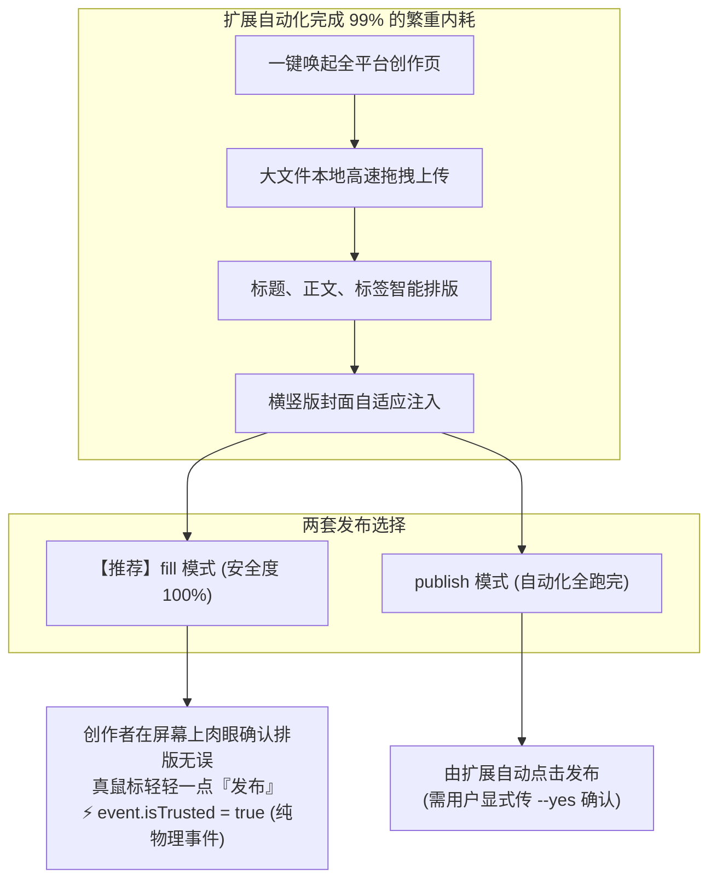

# 为什么基于真实 Chrome 扩展的分发方案能避免 90% 的封号与验证码拦截？

在自媒体多平台自动化运营中，“封号、限制推流、降权、无休止的人机滑块”是每个使用过自动化发布工具创作者挥之不去的噩梦。

很多人以为“只要设置了随机等待延时，自动化就不会被平台识别”。然而在 2024~2026 年的主流社交媒体平台（小红书、抖音、微信视频号、B站、快手）眼里，这种简单的延时隐藏在现代前端风控探针面前几乎完全形同虚设。

本文将从现代内容平台**前端风控对抗的底层机制**出发，深度解析为什么基于**真实 Chrome 扩展（如 EasyPost）**的分发模式能够彻底规避 90% 以上的风控与封号风险。

---

## 一、 现代平台前端反爬与风控体系是如何运作的？

各大平台的内容发布后台（如小红书创作者服务平台、抖音创作服务平台）部署了高度复杂的风控 SDK。当一个页面被加载并尝试提交内容时，平台至少会进行以下四个层级的交叉核验：

### 1. 运行环境指纹审计（Environment Auditing）
- **自动化标识探测**：检测 `navigator.webdriver` 是否为 `true`，检测 `window.chrome` 是否被注入了异常挂钩；
- **CDP 探针检测**：主流自动化测试框架（Puppeteer/Playwright）使用的 Chrome DevTools Protocol 会在 V8 引擎内留下不可磨灭的底层钩子和特殊的报错堆栈（Call Stack）；
- **硬件与传感器一致性**：检测屏幕分辨率、颜色深度、WebGL 渲染流水线、已安装系统字体、音频指纹是否与一台真实普通电脑完全匹配。许多无头（Headless）环境由于缺乏真实显卡和音频硬件，指纹极其假。

### 2. 用户行为轨迹与生物动力学特征（Biometrics & Interaction Timing）
- **鼠标轨迹动力学**：真人移动鼠标具有自然的加速度、减速度、微小的生理抖动与曲线弧度；而自动化脚本生成的贝塞尔曲线或瞬移点击缺乏微观随机性；
- **键盘按键时序**：真人打字每个字符之间的 `keydown` 与 `keyup` 间隔在 50ms~300ms 之间且呈非高斯分布，而脚本通过代码批量赋值 `input.value = "..."` 是一瞬间完成的。

### 3. DOM 事件的真实物理属性：`event.isTrusted`
这是所有前端自动化脚本的阿喀琉斯之踵：
- 当一个真实人类使用物理鼠标点击屏幕时，浏览器底层由操作系统硬件中断派发事件，其 JavaScript 事件对象中的 **`event.isTrusted` 属性由浏览器内核只读置为 `true`**；
- 当脚本通过 JavaScript 调用 `button.click()` 或 `dispatchEvent(new MouseEvent(...))` 时，**`event.isTrusted` 始终为 `false`**。
现代各大平台在“立即发布”按钮的事件监听器里，第一行代码往往就是检查 `event.isTrusted`。一旦检测到 `false`，后台风控直接打上“机器人疑似发布”的标签，轻则拦截弹滑块，重则隐式降权。

### 4. 账号登录态与设备 Session 关联度
- 如果一个账号发布内容时所使用的 IP、User-Agent、设备指纹与该账号日常刷视频、看笔记的常用设备长期不一致（例如平时用 iPhone 登录，发布时却来自云服务器的 Linux Chromium），极易触发异地登录风控拦截。

---

## 二、 为什么传统 Python/RPA 脚本总是频频翻车？

| 常见问题 | 传统脚本/RPA 的做法 | 平台风控的反应 |
| :--- | :--- | :--- |
| **滑块验证码** | 脚本卡死，或截屏发给第三方打码平台识别坐标后模拟拖动 | 模拟拖动的速度与微抖动不符合人体学特征，二次校验失败，提示“操作过于频繁，请稍后再试” |
| **短信二次验证** | 脚本中断，要求用户在终端手动输入验证码 | 频繁异地/异常设备验证导致账号信用分持续扣减 |
| **作品审核推流** | 通过非标准浏览器提交发布请求 | 平台将作品归类为“营销号批量分发”，进入冷宫审核池，播放量仅维持在个位数 |

---

## 三、 EasyPost（真实 Chrome 扩展方案）的破局之道

EasyPost 彻底摒弃了“脱离真实浏览器、造假指纹、假装正常人”的逆向死胡同，直接采用 **“原生寄生于创作者真实日常环境”** 的架构设计：

### 1. 100% 真实设备与上网指纹（无需伪装）
EasyPost 不需要启动任何独立的受控浏览器。它就运行在创作者每天用于看知乎、刷 B站、处理日常工作的真实 Chrome 浏览器中：
- 真实的显卡 WebGL 指纹；
- 真实的主机字体库与显示器色彩配置；
- 长期沉淀的日常 Cookies 与平台合规登录态。
在平台服务器看来，这完全是该账号主人的常用电脑在正常访问，**风控模型直接放行**。

### 2. Isolated World（隔离沙箱）安全保护
Chrome MV3 扩展的 Content Scripts 运行在严格受限的 **`Isolated World`**（独立隔离世界）中：
- 扩展可以正常读写页面的 DOM 节点（填写标题、插入段落、点击上传文件）；
- **页面的前端 JS 脚本完全无法访问扩展的全局作用域、函数与内存变量**；
- 平台部署的所有前端反爬探针、全局变量劫持与钩子代码，在物理层面上根本“看不见” EasyPost 扩展的存在！

### 3. 革命性的“双轨模式”：`fill`（填入）与 `publish`（发布）
针对最核心的 `event.isTrusted` 问题，EasyPost 提出了业内领先的“安全双轨工作流”：

#### 为什么强烈推荐日常使用 `fill` 模式？
- **繁重机械内耗 100% 自动化**：用户再也不用在 5~10 个平台重复打开网页、拖拽视频、复制粘贴文案、逐个选分类和封面；
- **最终发布保留物理硬件级触发**：由真人手指点击“发布”产生纯正的 `event.isTrusted = true` 物理事件。各大平台的反爬风控完全无法将此动作与普通用户的手工发帖区分开来，**从数学上彻底根除了被判定为自动化脚本封号的可能性**！

---

## 四、 总结

对抗现代风控的最佳手段不是“研发更复杂的假指纹与反检测补丁”，而是**顺应平台的安全红线，让自动化工作在合规受控的真实上下文中**。

EasyPost 借助 Chrome 扩展原生的沙箱优势与独创的 `fill` 模式，将内容创作者从无休止的机械分发中彻底解放，同时为自媒体矩阵资产筑起最稳固的安全护城河。
